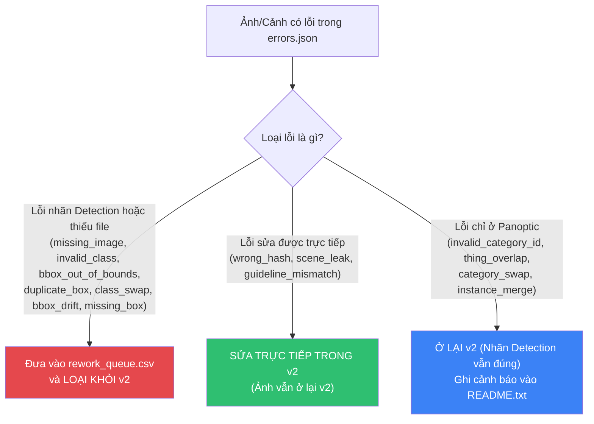

# Kế hoạch Thực hiện Chi tiết dành cho Đỗ Huy Kiên (Implementation Plan)

> **Họ và tên:** Đỗ Huy Kiên  
> **Mã số học viên (MSHV):** `2A202603216`  
> **Nhóm thực hiện:** Nhóm 05  
> **Lô luyện tập Seed:** `5007` (Mã lô: `lab250_43f248381e9d`)  
> **Vai trò nòng cốt:** Quản trị Dòng dõi Dữ liệu (Lineage), Quyết định Chất lượng (HOLD v1) & Đóng gói Bàn giao v2 Bất biến (Handover v2)  
> **Tài liệu tham chiếu:** [dataset_release_handover_plan_team.md](file:///d:/VinUni/Day10/K5-L23-Day10-2A202603192-NguyenBaDuy-Dataset-Release-Handover/dataset_release_handover_plan_team.md), [GUIDE.md](file:///d:/VinUni/Day10/K5-L23-Day10-2A202603192-NguyenBaDuy-Dataset-Release-Handover/GUIDE.md), [RUBRIC.md](file:///d:/VinUni/Day10/K5-L23-Day10-2A202603192-NguyenBaDuy-Dataset-Release-Handover/RUBRIC.md), [RULES.md](file:///d:/VinUni/Day10/K5-L23-Day10-2A202603192-NguyenBaDuy-Dataset-Release-Handover/RULES.md)

---

## 1. Tổng quan Nhiệm vụ & Deliverables của Kiên

Theo phân công trong `dataset_release_handover_plan_team.md` và quy định bài Lab Day 10, Kiên đảm nhận vai trò **Data Release & Lineage Manager** với các trọng trách và sản phẩm bàn giao cốt lõi:

| Mốc thời gian | Pha công việc | Nhiệm vụ cụ thể của Kiên | Deliverable / Sản phẩm bàn giao |
|---|---|---|---|
| **00' - 15'** | **Pha 0: Chuẩn bị** | Phối hợp cùng Duy, Hùng kiểm tra môi trường, sinh lô seed `5007` và xác nhận training run `R-021` được ghi vào `runs/lineage.jsonl`. | `runs/r5007/delivery`, `runs/lineage.jsonl` |
| **55' - 110'** | **Pha 2: Human Review** | Bắt buộc trực tiếp thẩm định bằng mắt **20% ứng viên** (ảnh từ 61% đến 80% từ `candidates.json`), ghi log khách quan vào `review_log.csv`. | 20% dòng trong `runs/r5007/review_log.csv` ($\ge 20$ ký tự/note) |
| **110' - 125'** | **Pha 3: Quyết định & Lineage** *(Chủ trì chính)* | - Tính tỷ lệ lỗi lô v1 dựa trên `errors.json` / 250 ảnh.<br>- Ra quyết định **HOLD** do tỷ lệ lỗi vượt ngưỡng 2% (chuẩn Day 7).<br>- Ghi nhận quyết định HOLD vào `lineage.jsonl`.<br>- Truy vấn phạm vi ảnh hưởng (Blast Radius) đối với model `R-021`. | Quyết định HOLD và sự kiện audit trong `runs/lineage.jsonl` |
| **125' - 165'** | **Pha 4: Bàn giao v2 Bất biến** *(Chủ trì chính)* | - Giữ nguyên v1, tuyệt đối không sửa thư mục `delivery/`.<br>- Xây dựng cấu trúc thư mục bàn giao `handover/lab250_43f248381e9d_v2/` gồm đúng **7 thành phần**.<br>- Phân loại và xử lý chuẩn xác 3 nhóm lỗi.<br>- Tạo đầy đủ 5 file metadata & báo cáo.<br>- Đóng gói bất biến với `pack_release.py` và ghi nhận release v2 vào `lineage.jsonl`.<br>- Kiểm thử nghiệm thu đạt **100% PASS (H1 đến H15)** trên `check_handover.py`. | Thư mục `handover/lab250_43f248381e9d_v2/`, file `.sha256`, bản ghi release trong `lineage.jsonl` |
| **195' - 235'** | **Pha 6b: Đề ẩn (40 phút)** | Cùng nhóm tác chiến: xem nhanh 20% ứng viên đề ẩn (16 phút tập trung) và sẵn sàng xuất gói bàn giao submission. | Kết quả review trong `submission/de_an/review_log.csv` |

---

## 2. Tiêu chí Nghiệm thu Kỹ thuật (Acceptance Criteria: H1 - H15)

Kiên là người chịu trách nhiệm chính đảm bảo toàn bộ các mã kiểm tra từ **H1 đến H15** của script `scripts/check_handover.py` đều đạt trạng thái `[PASS]`:

| Mã kiểm | Nội dung kiểm tra | Tiêu chí đạt chuẩn kỹ thuật | Cách xử lý của Kiên |
|---|---|---|---|
| **H1** | Tính bất biến của v1 | Mã băm sha256 của `manifest.json` + `metadata.json` của `delivery/` không đổi; không sửa file nhãn/mask trong v1. | **Tuyệt đối không sửa bất kỳ file nào trong thư mục `delivery/`**. Mọi chỉnh sửa chỉ được thực hiện trong thư mục `handover/`. |
| **H2** | Lỗi luật trong `errors.json` | `errors.json` có mặt và chứa đủ các lỗi luật mức file (`missing_image`, `wrong_hash`, `guideline_mismatch`, `scene_leak`, `invalid_class`, `bbox_out_of_bounds`). | Nhận file `errors.json` đã gộp từ Duy & Hùng (`merge_review.py`). |
| **H3** | Review log đầy đủ | Mọi lỗi gán nhãn trong `errors.json` phải có dòng `confirmed` trong `review_log.csv`; mỗi ghi chú $\ge 20$ ký tự, $\ge 70\%$ ghi chú không trùng nhau. | Kiểm tra phần 20% review của bản thân viết đúng format, miêu tả vật thể thật rõ nét, độ dài $> 20$ ký tự. |
| **H4** | Đủ 7 thành phần v2 | Thư mục v2 có đủ 7 phần: `images`, `labels`, `manifest.csv`, `label_summary.csv`, `truyvet.csv`, `README.txt`, `rework_queue.csv`. | Tự động tạo bằng script `scripts/build_handover_v2.py`. |
| **H5** | Phân loại Rework & V2 | - `images/` và `labels/` khớp nhau hoàn toàn.<br>- Toàn bộ ảnh có lỗi nhãn detection hoặc thiếu file phải vào `rework_queue.csv` và **bị loại khỏi v2**.<br>- Ảnh lỗi chỉ ở Panoptic **ở lại v2**.<br>- Ảnh trong `rework_queue` phải nằm trong `errors.json`. | Tách đúng 7 loại lỗi Detection (`missing_image`, `invalid_class`, `bbox_out_of_bounds`, `duplicate_box`, `class_swap`, `bbox_drift`, `missing_box`) sang rework. Giữ lại lỗi Panoptic trong v2. |
| **H6** | Đúng phân công Rework | Các ảnh trong `rework_queue.csv` phải map đúng `annotator` và `reviewer` gốc theo `jobs.csv`. | Đọc `job_id` của ảnh từ `metadata.json`, tra sang `jobs.csv` lấy đúng `annotator` và `reviewer`. |
| **H7** | Nhãn v2 giữ nguyên | File nhãn trong `v2/labels/` phải giữ nguyên sha256 như v1 (không sửa tay nội dung file `.txt`). | Sao chép nguyên vẹn từ `delivery/labels/`, không sửa tay tọa độ. |
| **H8** | Manifest v2 chuẩn xác | `manifest.csv` liệt kê đúng mọi file trong `images/` và `labels/` với mã sha256 thật. | Quét toàn bộ file trong `v2/images` và `v2/labels`, tính SHA256 trên byte nhị phân. |
| **H9** | Bảng tổng hợp nhãn | `label_summary.csv` thống kê đủ 80 class (theo tên trong `classes.txt`) và có dòng `TOTAL` khớp tổng số box. | Đếm box từ toàn bộ file nhãn v2, đối chiếu với 80 lớp chuẩn. |
| **H10** | Truy vết chuẩn hóa | `truyvet.csv` có mỗi ảnh một dòng, `job_id`/`annotator`/`reviewer`/`guideline` lấy chuẩn theo `jobs.csv`. | **Quan trọng:** Cột `guideline` phải lấy theo `jobs.csv`, không lấy theo `metadata.json` vì metadata có thể bị lỗi mismatch. |
| **H11** | Triệt tiêu Leak train/val | Trong `truyvet.csv`, không còn bất kỳ `scene_id` nào vừa có ảnh ở `train` vừa có ảnh ở `val`. | Đưa toàn bộ ảnh trong cùng một cảnh (`scene_id`) về chung một split thống nhất (theo đa số). |
| **H12** | Khớp định danh README | `README.txt` ghi đúng `Release: <id>_v2`, `Parent: <id>`, số ảnh và số nhãn khớp hoàn toàn với thực tế v2. | Điền tự động chính xác từ số lượng file và số box đếm được. |
| **H13** | Khớp QC & Quyết định | - Dòng `QC v1:` đúng `<số lỗi>/250 = <x.x%>`<br>- `Kết luận v1:` là `Hold` do tỷ lệ $> 2\%$<br>- Có `Kết luận v2: Release`. | Khớp chính xác số lỗi từ `errors.json` và số ảnh gốc (250). |
| **H14** | Nhất quán Lineage | `runs/lineage.jsonl` có sự kiện `decision` HOLD cho lô v1 và `release` cho lô v2 kèm `--parent`. | Chạy đúng cú pháp lệnh `scripts/lineage.py`. |
| **H15** | Bất biến file nén | Đóng gói lại v2 bằng `pack_release.py` sinh ra đúng mã SHA256 ghi trong file `.sha256`. | Chạy `scripts/pack_release.py` sau khi hoàn tất mọi file trong v2. |

---

## 3. Hướng dẫn Thực hiện Chi tiết Từng Bước (Step-by-Step Execution Guide)

### Bước 1: Phối hợp Pha 0 & Pha 2 (Chuẩn bị & Human Review)

1. **Khởi tạo môi trường (Pha 0):**
   ```powershell
   # Tải dữ liệu công khai nếu chưa có
   py scripts/download_public.py

   # Tạo lô luyện tập Seed 5007
   py scripts/run_lab.py --seeds 5007
   ```
   *Kiểm tra:* Thư mục `runs/r5007/delivery` xuất hiện, mã lô là `lab250_43f248381e9d`.

2. **Xem ảnh ứng viên 20% (Pha 2):**
   - Đợi Duy và Nhật Anh chạy validator sinh ra `runs/r5007/candidates.json`.
   - Hùng chia danh sách: **Kiên nhận các ảnh từ 61% đến 80%** của danh sách ứng viên.
   - Sử dụng công cụ xem ảnh trực quan:
     ```powershell
     py scripts/visualize_helper.py --run runs/r5007 --image <tên_ảnh>
     ```
   - Điền nhận định vào phần của mình trong `runs/r5007/review_log.csv` theo quy chuẩn:
     * `class_swap,confirmed,"mo anh: xe tai thung kin phia sau, detection ghi nham car; panoptic ghi truck dung"`
     * `category_swap,confirmed,"mo anh: con cho dang chay tren bai co, detection ghi dog dung; panoptic ghi cat"`
     * `bbox_drift,rejected,"hai nguoi dung sat nhau bi cành cay che mot phan, box detection van hop ly"`
     * > [!IMPORTANT]
       > Mỗi `note` bắt buộc phải **$\ge 20$ ký tự**, miêu tả trực quan vật thể thực tế nhìn thấy trong ảnh. Tuyệt đối không ghi chung chung như "OK", "lỗi", "sai nhãn" (sẽ bị trừ nửa điểm theo Rubric).

---

### Bước 2: Pha 3 - Ra Quyết định HOLD & Phân tích Lineage R-021

Sau khi Hùng chạy `merge_review.py` để sinh ra file `runs/r5007/errors.json`:

1. **Tính toán tỷ lệ lỗi của lô v1:**
   - Đếm số lượng ảnh/cảnh có lỗi trong `errors.json`.
   - Giả sử có 14 lỗi trên 250 ảnh:
     $$\text{Tỷ lệ lỗi} = \frac{14}{250} = 5.6\%$$
   - Đối chiếu ngưỡng chất lượng rủi ro Day 7: Ngưỡng cho phép tối đa là **2.0%**.
   - Vì $5.6\% > 2.0\% \rightarrow$ **Bắt buộc ra quyết định HOLD (từ chối phát hành v1)**.

2. **Ghi nhận quyết định HOLD vào nhật ký Dòng dõi (Lineage):**
   Chạy lệnh PowerShell:
   ```powershell
   py scripts/lineage.py record --event decision --release-id lab250_43f248381e9d --decision HOLD
   ```

3. **Truy vấn phạm vi ảnh hưởng (Blast Radius) đối với các mô hình:**
   Chạy lệnh:
   ```powershell
   py scripts/lineage.py impact --release-id lab250_43f248381e9d
   ```
   *Kết quả mong đợi hiển thị trên terminal:*
   ```text
   R-021: affected=True action=review_or_retrain
   ```

4. **Thực hiện Git Commit 1:**
   ```powershell
   git add runs/lineage.jsonl
   git commit -m "P3: Record HOLD decision and query blast radius for training run R-021"
   ```

> [!NOTE]
> **Hiểu bản chất kỹ thuật để vấn đáp:**  
> Tại sao việc sửa dataset tạo ra v2 sạch lại **không tự động khắc phục** mô hình `R-021` đã train?  
> *Trả lời:* Mô hình Machine Learning học bằng cách tối ưu hóa trọng số thông qua lan truyền ngược (Backpropagation) dựa trên dữ liệu đầu vào. Trọng số của mô hình `R-021` đã bị nhiễm gradient sai lệch từ các nhãn lỗi trong v1. Việc tạo ra dataset v2 mới chỉ là thay đổi dữ liệu trên đĩa, không can thiệp vào checkpoint trọng số đã lưu. Do đó, mô hình `R-021` bắt buộc phải được đánh giá lại (Review) hoặc huấn luyện lại từ đầu (Retrain).

---

### Bước 3: Pha 4 - Xây dựng Gói Bàn giao Lô v2 Bất biến

#### Quy tắc Phân loại Lỗi 3 Nhóm Cốt lõi:



#### Thực thi Tự động hóa bằng Script `build_handover_v2.py`:

Để đảm bảo không xảy ra bất kỳ sai sót thủ công nào về định dạng, mã băm hay sai lệch số liệu giữa 7 thành phần, Kiên chỉ cần chạy script tự động hóa được thiết lập sẵn:

```powershell
py scripts/build_handover_v2.py --run runs/r5007
```

Script này sẽ tự động:
1. Sao chép các ảnh và nhãn hợp lệ vào `runs/r5007/handover/lab250_43f248381e9d_v2/images/` và `labels/`.
2. Tạo `rework_queue.csv` gồm các ảnh lỗi detection, map đúng `annotator` và `reviewer` gốc theo `jobs.csv`.
3. Tạo `manifest.csv` chứa đúng mã SHA256 thật của từng file trong v2.
4. Tạo `label_summary.csv` thống kê đầy đủ 80 class và dòng `TOTAL`.
5. Tạo `truyvet.csv` đã giải quyết triệt để rò rỉ `scene_leak` (gom toàn bộ cảnh về 1 split) và lấy đúng `guideline` theo `jobs.csv`.
6. Soạn thảo `README.txt` chuẩn xác từng con số QC v1, kết luận v1 (Hold), kết luận v2 (Release) và ghi chú Panoptic.

---

### Bước 4: Đóng gói Bất biến & Ghi nhận Lineage v2

Sau khi thư mục `runs/r5007/handover/lab250_43f248381e9d_v2/` được tạo:

1. **Đóng gói bất biến tạo file `.sha256`:**
   ```powershell
   py scripts/pack_release.py runs/r5007/handover/lab250_43f248381e9d_v2
   ```
   *Kết quả:* Sinh ra file `runs/r5007/handover/lab250_43f248381e9d_v2.zip` và `lab250_43f248381e9d_v2.sha256`.

2. **Ghi nhận sự kiện phát hành v2 vào Lineage:**
   ```powershell
   py scripts/lineage.py record --event release --release-id lab250_43f248381e9d_v2 --parent lab250_43f248381e9d
   ```

3. **Thực hiện Git Commit 2:**
   ```powershell
   git add scripts/build_handover_v2.py runs/lineage.jsonl
   git commit -m "P4: Package immutable handover v2 and verify passing H1-H15"
   ```

---

### Bước 5: Chạy Thẩm định Nghiệm thu Toàn diện (H1 - H15)

Kiên thực hiện lệnh kiểm tra độc lập:
```powershell
py scripts/check_handover.py --run runs/r5007
```

**Mục tiêu bắt buộc:** Toàn bộ các dòng từ `H1` đến `H15` đều phải hiển thị `[PASS]`:
```text
  [PASS] H1   v1 (lab250_43f248381e9d) giữ nguyên
  [PASS] H2   errors.json có 14 lỗi, gồm đủ lỗi luật mức file
  [PASS] H3   review_log.csv: ... dòng, mọi lỗi gán nhãn đã được xem ảnh và xác nhận, ghi chú cụ thể
  [PASS] H4   lab250_43f248381e9d_v2/ đủ 7 phần
  [PASS] H5   v2 có ... ảnh; ... ảnh lỗi chuyển sang rework_queue, không nằm trong v2
  [PASS] H6   rework_queue ghi đúng người gán/người kiểm theo jobs.csv
  [PASS] H7   nhãn trong v2 giữ nguyên như đã gán (không sửa tay)
  [PASS] H8   manifest.csv: ... file, sha256 đúng
  [PASS] H9   label_summary.csv khớp (... nhãn)
  [PASS] H10  truyvet.csv: mỗi ảnh một dòng, job/người/guideline theo jobs.csv
  [PASS] H11  v2 không còn cảnh nằm ở cả train và val
  [PASS] H12  README.txt: tên lô, lô cha, số ảnh, số nhãn khớp
  [PASS] H13  QC v1 14/250 = 5.6% => Hold (ngưỡng 2%); có kết luận v2
  [PASS] H14  lineage: HOLD cho v1 và release v2 có parent v1
  [PASS] H15  đóng gói lại v2 ra đúng mã trong .sha256
```
*(Lưu ý: H16 và H17 sẽ PASS khi Cường hoàn thành `trace.json` và `security.md`).*

---

### Bước 6: Xuất bản Dữ liệu Nộp bài (Export Submission)

Khi toàn nhóm hoàn tất các pha:
```powershell
# Xuất dữ liệu sang thư mục submission/
py scripts/export_submission.py --run runs/r5007
```
*Kiểm tra cấu trúc:*
Thư mục `submission/r5007/handover/` chứa thư mục `lab250_43f248381e9d_v2/` và file `.sha256`. Tuyệt đối **không commit file `.zip`** lên git (script `export_submission.py` đã tự động lọc bỏ).

---

## 4. Kịch bản Tác chiến Đề ẩn 40 Phút (Dành riêng cho Kiên)

Khi giảng viên phát đề ẩn `de_an.zip`:

| Thời gian | Trọng tâm của Kiên | Hành động chi tiết |
|---|---|---|
| **00' - 05'** | Tiếp nhận đề | Phối hợp cùng Duy giải nén đề ẩn vào `delivery/` tại thư mục gốc. |
| **05' - 12'** | Đợi validator | Duy chạy `validator/validate.py delivery --out submission/de_an/rules.json --candidates submission/de_an/candidates.json`. Kiên sẵn sàng công cụ mở ảnh. |
| **12' - 28' (16 phút)** | **Tập trung Human Review** | Nhận 20% danh sách ứng viên đề ẩn từ Hùng. Mở xem trực tiếp trên `visualize_helper.py`, chốt verdict `confirmed` / `rejected` và viết note $\ge 20$ ký tự vào `submission/de_an/review_log.csv`. |
| **28' - 35'** | Phối hợp chốt lỗi | Hùng chạy `merge_review.py` ra `submission/de_an/errors.json`. Cường hoàn thiện `submission/de_an/trace.json`. Kiên rà soát lại review_log đảm bảo không có note nào bị ngắn dưới 20 ký tự. |
| **35' - 40'** | Kiểm tra & Push Git | Rà soát `git status`, đảm bảo không commit thư mục `delivery/` của đề ẩn. Commit và Push lên GitHub đúng giờ quy định. |

---

## 5. Cẩm nang Trả lời Vấn đáp (Oral Defense Cheatsheet - 3 Phút)

Giảng viên sẽ chọn ngẫu nhiên thành viên để hỏi trong 3 phút. Dưới đây là 4 câu hỏi trọng tâm mà Kiên cần nắm vững:

### Câu 1: Tại sao đổi sang dataset v2 sạch không tự sửa model đã train (R-021)?
> **Trả lời mẫu:**  
> "Mô hình học máy cập nhật các tham số trọng số (weights) thông qua quá trình tối ưu hóa lan truyền ngược (Backpropagation) dựa trên hàm Loss của các nhãn trong dataset v1. Khi dataset v1 bị lỗi, các gradient sai lệch đã được ghi trực tiếp vào trọng số của checkpoint `R-021`.  
> Việc chúng em tạo ra dataset v2 sạch chỉ là thay đổi tệp tin trên ổ đĩa, hoàn toàn không tác động đến checkpoint nhị phân đã lưu của model cũ. Do đó, mô hình `R-021` bắt buộc phải được đánh giá lại (Review) hoặc huấn luyện lại từ đầu (Retrain) trên dữ liệu sạch v2."

### Câu 2: Giải thích từng con số trong README.txt của lô v2?
> **Trả lời mẫu:**  
> - `Release: lab250_43f248381e9d_v2`: Tên lô phát hành mới, có hậu tố `_v2`.  
> - `Parent: lab250_43f248381e9d`: Định danh của lô cha v1 để đảm bảo khả năng truy vết dòng dõi dữ liệu (Data Lineage).  
> - `Số ảnh`: Tổng số ảnh sạch được giữ lại trong v2 (sau khi đã tách các ảnh lỗi nhãn Detection sang `rework_queue.csv`).  
> - `Số nhãn`: Tổng số bounding box đếm được trong toàn bộ file `.txt` của thư mục `labels/`, khớp đúng với dòng `TOTAL` trong `label_summary.csv`.  
> - `QC v1: 14/250 = 5.6%`: Tỷ lệ lỗi kiểm toán của lô v1 (14 ảnh/cảnh có lỗi trên tổng số 250 ảnh ban đầu).  
> - `Kết luận v1: Hold`: Vì tỷ lệ lỗi $5.6\% > 2.0\%$ (ngưỡng trần Day 7) nên lô v1 không đủ tiêu chuẩn phát hành.  
> - `Kết luận v2: Release`: Lô v2 đã loại bỏ các nhãn hỏng sang hàng đợi làm lại, sửa lỗi kỹ thuật, đảm bảo độ sạch 100% cho bài toán Detection.

### Câu 3: Mã băm SHA256 chứng minh điều gì và KHÔNG chứng minh điều gì?
> **Trả lời mẫu:**  
> - **Chứng minh:** Tính toàn vẹn dữ liệu (Data Integrity). Nó chứng minh rằng tệp tin nhận được không bị sửa đổi, thêm bớt hay hư hại dù chỉ 1 bit so với lúc niêm phong.  
> - **KHÔNG chứng minh:** Tính đúng đắn về mặt ngữ nghĩa (Data Quality / Semantic Correctness). Một file ảnh hoàn toàn có thể có mã băm SHA256 cực kỳ hợp lệ nhưng nội dung bên trong lại bị gán nhãn sai hoàn toàn (ví dụ: vẽ box con chó nhưng gán nhãn là ô tô).

### Câu 4: Khi kiểm tra một ảnh bất kỳ trong `review_log.csv` do thầy chỉ định, em đã thấy gì?
> **Trả lời mẫu:**  
> Mở ảnh ra trên màn hình và miêu tả trực quan:  
> "Dạ thưa thầy, ở ảnh này ứng viên được gợi ý là `class_swap` giữa `car` và `truck`. Khi mở ảnh lên, em thấy vật thể là một chiếc xe tải thùng kín lớn đang đỗ bên đường. Nhãn Detection ghi là class 2 (`car`) là sai, trong khi nhãn Panoptic ghi là class 7 (`truck`) là đúng. Do đó em kết luận `confirmed` cho lỗi `class_swap` của Detection và ghi chú rõ ràng vật thể nhìn thấy trong log."

---

## 6. Checklist Tự kiểm tra Nhanh trước khi Nộp bài

- [ ] File `runs/lineage.jsonl` có đủ: 1 sự kiện `inject`, 1 sự kiện `train` R-021, 1 sự kiện `decision` HOLD cho v1, 1 sự kiện `release` v2 có `--parent`.
- [ ] Đã chạy `scripts/build_handover_v2.py` tạo đủ 7 thành phần trong `handover/lab250_43f248381e9d_v2/`.
- [ ] Không có ảnh lỗi detection nào còn sót lại trong thư mục `v2/images/` và `v2/labels/`.
- [ ] Các ảnh lỗi panoptic vẫn ở lại trong v2 và được nêu tên trong `Ghi chú` của `README.txt`.
- [ ] Đã chạy `pack_release.py` sinh file `.sha256`.
- [ ] Chạy `check_handover.py --run runs/r5007` đạt đủ **15/15 PASS** phần của Kiên (H1 đến H15).
- [ ] Đã thực hiện đủ tối thiểu **2 Git commit** cá nhân mang tên Đỗ Huy Kiên.
- [ ] Sẵn sàng trả lời trôi chảy 4 câu hỏi vấn đáp 3 phút.
