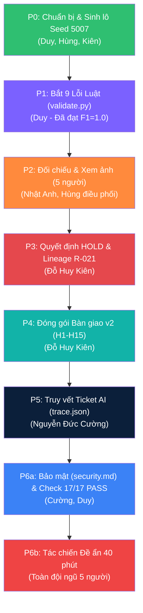

# Kế hoạch chi tiết thực hiện Lab Day 10: Bàn giao Dataset & Truy vết (Dataset Release Handover)

> **Nhóm thực hiện: Nhóm 05**  
> **Seed luyện tập chính thức: `5007`** (Mã lô: `lab250_43f248381e9d`)  
> **Repository:** [K5-L23-Day10-2A202603192-NguyenBaDuy-Dataset-Release-Handover](https://github.com/basduy05/K5-L23-Day10-2A202603192-NguyenBaDuy-Dataset-Release-Handover)

---

## 1. Phân công chính xác công việc cho 5 thành viên

Theo quy định bắt buộc của bài Lab ([RULES.md](file:///c:/Users/basduy05/Downloads/VINAI/lab/lab-day10/K5-L23-Day10-T005-Dataset-Release-Handover/RULES.md) & [RUBRIC.md](file:///c:/Users/basduy05/Downloads/VINAI/lab/lab-day10/K5-L23-Day10-T005-Dataset-Release-Handover/RUBRIC.md)):
- **Mỗi thành viên phải có tối thiểu 2 commit có ý nghĩa** trên Git bằng tài khoản cá nhân.
- **Tất cả 5 thành viên đều bắt buộc phải trực tiếp xem ảnh** ở Pha 2.
- **Tất cả thành viên phải chuẩn bị cho vòng vấn đáp 3 phút ngẫu nhiên** từ giảng viên.

| STT | Thành viên | MSHV | Vai trò chính | Trách nhiệm chi tiết & Deliverables | Chuẩn bị Vấn đáp (Oral Defense) |
|---|---|---|---|---|---|
| 1 | **Nguyễn Bá Duy** *(Trưởng nhóm)* | **2A202603192** | Kiến trúc Validator & 9 Lỗi Luật | - Quản trị repository, tiến độ các pha.<br>- Lập trình Core Engine `validator/validate.py` bắt trọn 9 lỗi luật (File, Bbox, Split, Guideline, Panoptic).<br>- Đảm bảo F1 lỗi luật = 1.0 trên `runs/r5007` và 0 lỗi trên `runs/clean`.<br>- Tham gia xem ảnh 20% ứng viên ở Pha 2.<br>- **Deliverable:** `validator/validate.py`, `runs/r5007/rules.json`. | Giải thích giải thuật bắt `wrong_hash` (tính lại SHA256 thay vì check độ dài), `duplicate_box` (cùng size, lệch 1-2px) và `thing_overlap`. |
| 2 | **Hoàng Nhật Anh** | **2A202603183** | Đối chiếu Chéo (Cross-check) & Đo Nhiễu | - Lập trình module Matching Detection $\leftrightarrow$ Panoptic trong `validator/validate.py`.<br>- Tính toán IoU, tọa độ tâm và độ bao phủ pixel mask.<br>- Thực nghiệm đo nhiễu COCO tự nhiên trên `runs/clean` (pool Calib) để thiết lập ngưỡng lọc tối ưu.<br>- Tham gia xem ảnh 20% ứng viên ở Pha 2.<br>- **Deliverable:** `candidates.json` (tinh gọn, lọc nhiễu tốt), báo cáo phân tích ngưỡng trong `REPORT.md`. | Giải thích vì sao lô sạch vẫn có ứng viên; vì sao báo thừa làm F1 tụt dốc; giải thuật phát hiện `bbox_drift` và `instance_merge`. |
| 3 | **Phạm Mạnh Hùng** | **2A202603240** | Visualize Tool & Điều phối Human Review | - Viết script công cụ hiển thị ảnh `scripts/visualize_helper.py` vẽ box YOLO và mask Panoptic để cả nhóm review nhanh.<br>- Phân chia danh sách ứng viên cho 5 thành viên thẩm định.<br>- Chuẩn hóa và tổng hợp `review_log.csv` (đảm bảo từng dòng $\ge 20$ ký tự, miêu tả vật thể thật, không trùng lặp note).<br>- Chạy `merge_review.py` chốt `errors.json`.<br>- Tham gia xem ảnh 20% ứng viên ở Pha 2.<br>- **Deliverable:** `scripts/visualize_helper.py`, `runs/r5007/review_log.csv`, `runs/r5007/errors.json`. | Trực tiếp mở 1 ảnh bất kỳ trong `review_log.csv` do giảng viên chỉ định và giải thích tại sao kết luận `confirmed` hoặc `rejected`. |
| 4 | **Đỗ Huy Kiên** | **2A202603216** | Quản trị Lineage & Đóng gói Bàn giao v2 | - Tính toán tỷ lệ lỗi lô v1 và thực thi lệnh ra quyết định HOLD (ngưỡng 2%).<br>- Thực thi `scripts/lineage.py` và giải trình Blast Radius của mô hình `R-021`.<br>- Xây dựng cấu trúc bàn giao lô `handover/<release_id>_v2/` gồm đúng 7 thành phần.<br>- Tách ảnh lỗi Detection sang `rework_queue.csv`, sửa `truyvet.csv` (guideline theo job, triệt tiêu leak), viết `README.txt`.<br>- Đóng gói bất biến với `pack_release.py` và đảm bảo đạt H1 - H15 của `check_handover.py`.<br>- Tham gia xem ảnh 20% ứng viên ở Pha 2.<br>- **Deliverable:** `handover/<release_id>_v2/`, `.sha256`, `runs/lineage.jsonl`. | Giải thích tại sao đổi dataset không tự sửa model đã train; giải thích từng con số trong `README.txt` và mã băm SHA256 chứng minh điều gì. |
| 5 | **Nguyễn Đức Cường** | **2A202603040** | Truy vết Sự cố Ticket & An toàn Dữ liệu | - Phân tích `incoming/ticket.md` và `guideline/changelog.md` để xác định lớp bị đổi quy tắc (`rule_class`).<br>- Lập trình trích xuất chính xác 2 tầng ảnh hưởng: `tier_a` (đã báo), `tier_b` (chưa báo), và danh sách `notify` vào `trace.json`.<br>- Soạn thảo tài liệu tuân thủ bảo mật `security.md` (3 ca gắn với lô thực tế, ca khuôn mặt kết luận HOLD và nêu tên ảnh thật).<br>- Đồng kiểm định đạt 17/17 PASS (H1 - H17) trên `check_handover.py`.<br>- Tham gia xem ảnh 20% ứng viên ở Pha 2.<br>- **Deliverable:** `runs/r5007/trace.json`, `runs/r5007/security.md`. | Giải thích sự khác biệt giữa `tier_a` và `tier_b`; vì sao ca khuôn mặt phải HOLD + báo cáo thay vì tự ý làm mờ ảnh. |

---

## 2. Hướng dẫn chi tiết từng bước (Step-by-Step Guide) kèm Giải thích lý do



### Pha 0: Khởi tạo Lô Dữ liệu & Môi trường (~15 phút)

#### Các bước thực hiện:
1. Đảm bảo dữ liệu nguồn đã có:
   ```powershell
   py scripts/download_public.py
   ```
2. Tạo lô luyện tập Seed `5007`:
   ```powershell
   py scripts/run_lab.py --seeds 5007
   ```
   *Kết quả đã tạo:* Thư mục `runs/r5007/delivery` với `release_id = lab250_43f248381e9d` và ghi sự kiện train `R-021` vào `runs/lineage.jsonl`.
3. Tạo lô sạch để đo nhiễu tự nhiên:
   ```powershell
   py scripts/inject_release.py --seed 5 --no-faults --out runs/clean
   ```
4. Cập nhật thông tin nhóm vào `submission/TEAM.md` (Đã hoàn thành).

---

### Pha 1: Phát hiện 9 Lỗi Luật (`validator/validate.py`) (~40 phút)

#### Các bước thực hiện:
Chạy script validator (đã viết sẵn tại `validator/validate.py`):
```powershell
# Chạy trên lô sạch runs/clean (Kỳ vọng: 0 lỗi luật)
py validator/validate.py runs/clean/delivery --out runs/clean/rules.json

# Chạy trên lô luyện tập r5007
py validator/validate.py runs/r5007/delivery --out runs/r5007/rules.json --candidates runs/r5007/candidates.json

# Kiểm tra F1 lỗi luật
py -c "import shutil; shutil.copy('runs/r5007/rules.json', 'runs/r5007/errors.json')"
py scripts/score_findings.py --run runs/r5007
```

#### Giải thích lý do vì sao cần bắt 9 lỗi luật:
1. **`missing_image`**: Ảnh có trong manifest nhưng file vật lý không tồn tại trên ổ cứng. Nếu đưa vào loader của PyTorch/YOLO sẽ gây lỗi `FileNotFoundError` và dừng đột ngột training job.
2. **`wrong_hash`**: Nội dung ảnh bị thay đổi hoặc corrupt dù tên file vẫn đúng. Phải tính lại SHA256 thật của file để phát hiện vi phạm tính toàn vẹn (Data Integrity).
3. **`invalid_class`**: Class ID trong file nhãn nằm ngoài khoảng $[0, 79]$ (ví dụ class 80). Gây lỗi out-of-range index trong hàm tính Loss (Cross-Entropy).
4. **`bbox_out_of_bounds`**: Tọa độ box tràn ra ngoài mép ảnh ($x - w/2 < -0.01$ hoặc $x + w/2 > 1.01$). Gây sai lệch ma trận anchor box.
5. **`duplicate_box`**: Cùng class, cùng kích thước, chỉ lệch 1-2 pixel. Không thể dùng IoU thấp để lọc vì COCO có nhiều vật thể tự nhiên chồng lấn nhau; chỉ phát hiện khi khoảng cách tâm cực nhỏ ($\le 2$px) và kích thước trùng khớp.
6. **`scene_leak`**: Cùng một đoạn cảnh quay (`scene_id`) mà 1 số ảnh nằm ở `train`, số khác nằm ở `val`. Gây rò rỉ dữ liệu (Data Leakage) nghiêm trọng, làm mô hình học vẹt cảnh nền.
7. **`guideline_mismatch`**: Guideline của ảnh ghi trong metadata lệch với guideline của job trong `jobs.csv`. Vi phạm cam kết hợp đồng gán nhãn của lô.
8. **`invalid_category_id`**: Phân đoạn panoptic chứa mã category không nằm trong ontology danh mục.
9. **`thing_overlap`**: Diện tích segment khai báo trong JSON lớn hơn số pixel thực tế đếm được trong mặt nạ mask PNG (vật thể bị đè lên làm mất điểm ảnh).

*Kết quả đo:* **Đã đạt F1 lỗi luật = 1.0** (10 lỗi luật được phát hiện chính xác trên seed 5007).

---

### Pha 2: Đối chiếu Detection ↔ Panoptic & Human Review (~55 phút)

#### Các bước thực hiện:
1. **Trích xuất ứng viên bất đồng**:
   Validator đã trích xuất danh sách nghi vấn vào `runs/r5007/candidates.json`.
2. **Hiển thị trực quan để xem ảnh**:
   Sử dụng script `scripts/visualize_helper.py` để mở từng ảnh có trong `candidates.json`:
   ```powershell
   py scripts/visualize_helper.py --run runs/r5007 --image <tên_ảnh>
   ```
3. **Phân chia 5 người cùng xem ảnh**:
   - Nguyễn Bá Duy: Ảnh 01 đến 20%
   - Hoàng Nhật Anh: Ảnh 21 đến 40%
   - Phạm Mạnh Hùng: Ảnh 41 đến 60%
   - Đỗ Huy Kiên: Ảnh 61 đến 80%
   - Nguyễn Đức Cường: Ảnh 81 đến 100%
4. **Ghi nhật ký `runs/r5007/review_log.csv`**:
   Mỗi người ghi kết luận theo định dạng: `image,type,verdict,note`
   - Nếu phát hiện Detection gán nhầm: `class_swap,confirmed,"mo anh: xe tai thung kin phia sau, detection ghi nham car; panoptic ghi truck dung"`
   - Nếu phát hiện Panoptic gán nhầm: `category_swap,confirmed,"mo anh: con cho dang chay ngoai san co, detection ghi dog dung; panoptic ghi nham cat"`
   - Nếu lệch tự nhiên do che khuất: `bbox_drift,rejected,"hai nguoi dung sat nhau bi cành cay che khuat mot phan, box hop ly"`
   - *Lưu ý:* `note` bắt buộc $\ge 20$ ký tự, miêu tả khách quan những gì mắt người nhìn thấy trong ảnh.
5. **Gộp lỗi luật và lỗi gán nhãn đã xác nhận**:
   ```powershell
   py scripts/merge_review.py --rules runs/r5007/rules.json --review runs/r5007/review_log.csv --out runs/r5007/errors.json
   py scripts/score_findings.py --run runs/r5007
   ```

#### Giải thích lý do:
- **Tại sao báo hết ứng viên lại làm F1 tụt?**
  COCO tự nhiên có nhiều độ lệch (vật thể bị che, ranh giới mờ, đám đông). Nếu code tự động báo mọi độ lệch là lỗi, số lượng False Positive (báo thừa) sẽ cực lớn. Điểm số tính bằng $F_1 = \frac{2 \cdot P \cdot R}{P + R}$, khi Precision giảm mạnh do báo thừa, F1 sẽ sụt giảm nghiêm trọng (từ 0.9 xuống dưới 0.6). Do đó, sự thẩm định bằng mắt của con người (Human-in-the-loop) là bước không thể thiếu.

---

### Pha 3: Quyết định Chất lượng & Dòng dõi Dữ liệu (Lineage) (~15 phút)

#### Các bước thực hiện (Đỗ Huy Kiên phụ trách):
1. **Tính tỷ lệ lỗi của lô v1**:
   Số lượng lỗi trong `errors.json` / 250 ảnh. Ví dụ nếu có 14 ảnh lỗi $\rightarrow 14 / 250 = 5.6\% > 2\%$.
2. **Ghi nhận quyết định HOLD vào lineage**:
   ```powershell
   py scripts/lineage.py record --event decision --release-id lab250_43f248381e9d --decision HOLD
   ```
3. **Truy vấn phạm vi ảnh hưởng (Blast Radius)**:
   ```powershell
   py scripts/lineage.py impact --release-id lab250_43f248381e9d
   ```
   Dòng xuất hiện: `R-021: affected=True action=review_or_retrain`.

#### Giải thích lý do:
- Theo nguyên tắc quản lý rủi ro Day 7, ngưỡng cho phép lỗi tối đa là 2%. Vượt quá 2% thì lô dữ liệu không đạt tiêu chuẩn phát hành.
- **Tại sao phải retrain run `R-021`?** Mô hình học máy cập nhật trọng số mạng dựa trên dữ liệu đầu vào. Trọng số của `R-021` đã bị nhiễm gradient sai lệch từ các nhãn lỗi trong v1. Việc tạo ra dataset v2 sạch không làm thay đổi trọng số đã lưu của mô hình cũ; ta bắt buộc phải đánh giá lại hoặc huấn luyện lại (Retrain).

---

### Pha 4: Bàn giao Lô v2 Bất Biến (Immutable Handover v2) (~40 phút)

#### Các bước thực hiện (Đỗ Huy Kiên phụ trách):
1. **Khởi tạo thư mục v2**: `runs/r5007/handover/lab250_43f248381e9d_v2/`
2. **Quy tắc phân loại và xử lý lỗi**:
   - **Lỗi sửa trực tiếp trong v2**:
     - `wrong_hash`: Mở ảnh xem kiểm tra, nếu ảnh xem bình thường thì chỉ sai manifest $\rightarrow$ ghi mã SHA256 mới vào `manifest.csv`.
     - `scene_leak`: Sửa trong `truyvet.csv` để toàn bộ ảnh trong cùng 1 cảnh thuộc về 1 split thống nhất.
     - `guideline_mismatch`: Sửa lại `guideline` trong `truyvet.csv` chuẩn theo `jobs.csv`.
   - **Lỗi gán nhãn Detection hoặc thiếu file** (`missing_image`, `invalid_class`, `bbox_out_of_bounds`, `duplicate_box`, `class_swap`, `bbox_drift`, `missing_box`):
     - Rút toàn bộ ảnh này ra khỏi `images/` và `labels/` của v2.
     - Ghi danh sách các ảnh này vào `rework_queue.csv` (`image,type,annotator,reviewer,action`), phân công đúng `annotator` và `reviewer` gốc theo `jobs.csv`.
   - **Lỗi chỉ ở Panoptic** (`invalid_category_id`, `thing_overlap`, `category_swap`, `instance_merge`):
     - Nhãn Detection của ảnh vẫn hoàn toàn sạch, nên ảnh **vẫn ở lại trong v2**.
     - Liệt kê các ảnh này vào phần *Ghi chú* trong `README.txt` để gửi cảnh báo sang team Panoptic.
3. **Sinh các bảng dữ liệu**:
   - `manifest.csv`: Danh sách `file,sha256` cho mọi file trong `images/` và `labels/`.
   - `label_summary.csv`: Tổng hợp số lượng box theo 80 class, dòng cuối là `TOTAL`.
   - `truyvet.csv`: Truy xuất nguồn gốc cho từng ảnh trong v2.
   - `README.txt`: Khai báo thông số QC v1, kết luận v1 (HOLD), kết luận v2 (RELEASE), và ghi chú chi tiết.
4. **Đóng gói và kiểm tra**:
   ```powershell
   py scripts/pack_release.py runs/r5007/handover/lab250_43f248381e9d_v2
   py scripts/lineage.py record --event release --release-id lab250_43f248381e9d_v2 --parent lab250_43f248381e9d
   py scripts/check_handover.py --run runs/r5007
   ```
   Kỳ vọng: Đạt toàn bộ PASS từ **H1 đến H15**.

#### Giải thích lý do:
- **Nguyên tắc Bất biến (Immutability)**: Không bao giờ sửa đè v1 nhằm đảm bảo tính truy nguyên lịch sử (Auditability). Nếu v1 bị sửa đè, ta sẽ mất bằng chứng kiểm toán về lý do tại sao mô hình `R-021` bị lỗi.

---

### Pha 5: Truy vết Sự cố Ticket của Team AI (~20 phút)

#### Các bước thực hiện (Nguyễn Đức Cường phụ trách):
1. Đọc file `runs/r5007/delivery/incoming/ticket.md` và `guideline/changelog.md`:
   - Xác định lớp đối tượng bị thay đổi quy ước (`rule_class`).
   - Xác định danh sách cảnh bị team AI phản ánh (`reported_scenes`).
2. Trích xuất vào `runs/r5007/trace.json`:
   - **`tier_a`**: Các ảnh thuộc các cảnh trong `reported_scenes`, thuộc các job làm theo guideline cũ (`v1.2`), VÀ có chứa ít nhất 1 bounding box của lớp `rule_class`.
   - **`tier_b`**: Các ảnh còn lại trong lô thỏa mãn cùng điều kiện trên nhưng chưa được team AI nêu ra.
   - **`notify`**: Danh sách toàn bộ mã người gán (`annotator`) và người kiểm (`reviewer`) của các job chứa ảnh ở cả `tier_a` và `tier_b`.
3. Kiểm tra kết quả truy vết:
   ```powershell
   py scripts/score_findings.py --run runs/r5007
   ```
   Kỳ vọng: Đạt điểm F1 tối đa cho truy vết (H16 PASS).

---

### Pha 6: Hoàn thiện Bảo mật & Sẵn sàng Đề ẩn (~50 phút)

#### Pha 6a: Hoàn thiện `security.md` (Nguyễn Đức Cường phụ trách - 10 phút):
Soạn thảo `runs/r5007/security.md` trả lời 3 câu hỏi thực tế:
1. **Ca USB**: Giải thích vì sao chép dữ liệu ra USB hoặc gửi về email cá nhân là vi phạm nghiêm trọng chính sách bảo mật (nguy cơ thất thoát dữ liệu - Data Exfiltration).
2. **Đánh giá 5 hành vi**: Đưa ra nhận định Được / Không được kèm lý do pháp lý và kỹ thuật.
3. **Ca Khuôn mặt**: Khi phát hiện ảnh có mặt người rõ nét $\rightarrow$ Quyết định: **HOLD lô dữ liệu**, báo cáo ngay cho Lead và DPO (Data Protection Officer). **Tuyệt đối không tự ý làm mờ hay xóa file** vì sẽ làm hỏng mã băm SHA256 đã niêm phong và che giấu lỗi hệ thống ở khâu ẩn danh hóa ban đầu. Nêu rõ ít nhất 1 tên ảnh có mặt người trong lô `r5007`.

Chạy kiểm tra toàn diện:
```powershell
py scripts/check_handover.py --run runs/r5007
```
**Kỳ vọng: Toàn bộ 17 mã kiểm (H1 - H17) đều đạt PASS!**

#### Pha 6b: Kịch bản tác chiến Đề ẩn 40 phút (Toàn đội ngũ 5 người):
- **00' - 05'**: Nhận đề ẩn, giải nén vào `runs/de_an/delivery/`.
- **05' - 12'**: Chạy `validator/validate.py runs/de_an/delivery --out runs/de_an/rules.json --candidates runs/de_an/candidates.json`.
- **12' - 28' (16 phút Human Review tập trung)**: Chia đều ứng viên cho cả 5 thành viên (mỗi người ~3-4 ảnh), mở xem nhanh trên `visualize_helper.py`, chốt `de_an/review_log.csv`.
- **28' - 33'**: Gộp lỗi bằng `merge_review.py` ra `de_an/errors.json`.
- **33' - 37'**: Chạy script trích xuất `de_an/trace.json`.
- **37' - 40'**: Chạy `export_submission.py`, kiểm tra checklist, commit và push lên GitHub.

---

## 3. Danh mục Deliverables & Trách nhiệm Commit Git

Để đạt tối đa điểm mục 6 trong Rubric, mỗi thành viên phải thực hiện tối thiểu 2 commit có nội dung độc lập:

1. **Nguyễn Bá Duy**:
   - `Commit 1`: "P1: Implement core rule validator in validator/validate.py"
   - `Commit 2`: "P1: Verify rule validator on clean set and r5007, reach rule F1=1.0"
2. **Hoàng Nhật Anh**:
   - `Commit 1`: "P2: Implement IoU and pixel containment cross-check logic in validator"
   - `Commit 2`: "P2: Benchmark candidate noise on clean calib pool and analyze thresholds"
3. **Phạm Mạnh Hùng**:
   - `Commit 1`: "P2: Add visualize helper tool for rapid human inspection"
   - `Commit 2`: "P2: Complete human review log and merge validated errors into errors.json"
4. **Đỗ Huy Kiên**:
   - `Commit 1`: "P3: Record HOLD decision and query blast radius for training run R-021"
   - `Commit 2`: "P4: Package immutable handover v2 and verify passing H1-H15"
5. **Nguyễn Đức Cường**:
   - `Commit 1`: "P5: Trace AI ticket blast radius and generate trace.json"
   - `Commit 2`: "P6: Complete security compliance report and verify full H1-H17 PASS"
